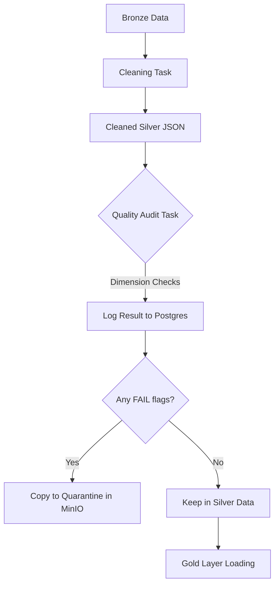

# Data Quality Audit System Guide

This system ensures that your Medallion architecture remains clean, trustworthy, and compliant with professional data governance standards (Spec Section 9).

## 1. How it Works (The Workflow)

The audit logic is embedded directly into the **Silver Layer DAG**. It follows these steps:

## 2. The 3 Dimensions of Quality

As per your project requirements, we audit the data across three specific dimensions:

| Dimension | Logic | Purpose |
| :--- | :--- | :--- |
| **COMPLÉTUDE** (Completeness) | Checks if `title` or `published_at` are empty. | Ensures every record has a header and a timestamp. |
| **VALIDITÉ** (Validity) | Checks if content is empty or < 50 words. | Filters out broken scrapes, empty pages, or "clickbait" snippets. |
| **COHÉRENCE** (Coherence) | Checks if the language is "unknown". | Ensures the text is readable and correctly processed by the NLP engine. |

## 3. What It Does (Key Actions)

### 📊 Real-time Monitoring
Instead of just crashing the pipeline when it finds bad data, the system logs the **audit results** in the `quality_logs` table. This allows the **Dashboard** to show you exactly how "healthy" your pipeline is without stopping the flow of good data.

### 🛡️ Data Quarantine
Bad articles are automatically moved to:
`silver-data/quarantine/hespress/YYYY/MM/DD/`
This is like a "recycle bin" for data. It allows you to inspect why certain articles failed without them polluting your clean **Gold** warehouse.

### 📜 Automated Governance
By keeping a log of every test (`id`, `url`, `dimension`, `test_name`, `status`), you have a complete **Audit Trail**. This satisfies the "Data Governance" requirement of your project, showing that you can trace the history and quality of every single record.

---

## 🛠️ How to View the Results
1. **In the Dashboard**: Click the **"🛡️ Data Quality Audit"** tab.
2. **In Postgres**: Run `SELECT * FROM quality_logs;`.
3. **In MinIO**: Browse the `silver-data` bucket under the `quarantine/` prefix.
